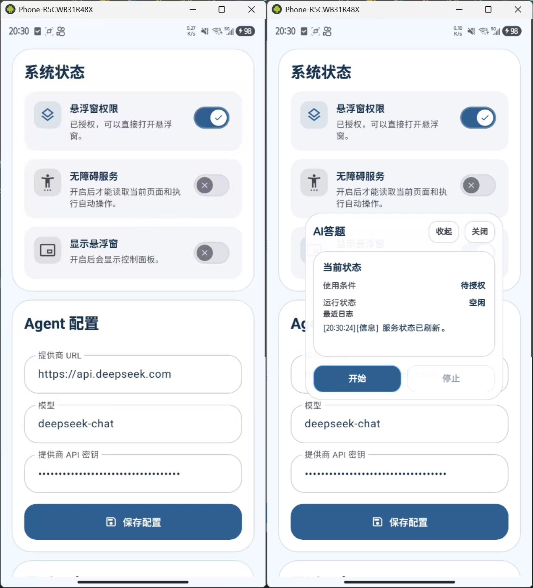

</think>

# flutter_answer

An answer assistance console built upon Flutter, Android accessibility services, and native floating window capabilities. The app centrally manages system permissions, model configurations, Agent runtime states, and native tool invocations. It automatically halts when entering submission-related pages, requiring the user to manually confirm the final submission.

> This project is intended solely for learning, academic exchange, and technical verification. Please verify the target platform's rules, device environment, and account security requirements before use.

## Project Preview



The demonstration video for Xuetong (Chaoxing) is located at [assets/videos/example.mp4](assets/videos/example.mp4).

## Core Capabilities

- Request and detect floating window permissions, controlling the display, closing, and movement of the native floating window.
- Check the status of accessibility services and redirect to system settings to complete authorization.
- Configure AI provider URL, API Key, model name, and runtime protection thresholds.
- Orchestrate model planning based on LangChain, and invoke Android native tools via Platform Channels.
- Read question context, page structure, and UI snapshots to execute atomic operations such as clicking, typing, scrolling, and navigating back.
- Synchronize logs and states between the main app, Agent runtime, and floating window panel.
- Automatically stops when reaching submission pages, submission pop-ups, or unanswered question warnings to prevent direct final submission.

## Applicable Environment

### Development Environment

- Flutter: `3.41.2` or a compatible version
- Dart: `3.11.0` or a compatible version
- Android Gradle Plugin and Kotlin versions are determined by the project's Gradle configuration
- JDK: `17`

### Runtime Environment

- Android device or emulator.
- Requires network access to request configured large model services.
- Requires manual user authorization for floating window and accessibility service permissions.
- Floating windows and accessibility features heavily rely on Android system behaviors; non-Android platforms are not within the current primary scope.

## Quick Start

1. Install dependencies:

   ```shell
   flutter pub get
   ```

2. Run the application:

   ```shell
   flutter run
   ```

3. Complete the following steps sequentially on the home page:

   - Enable floating window permission.
   - Enable accessibility service.
   - Enter the provider URL, API Key, and model name.
   - Save the configuration.
   - Open the target question page.
   - Display the floating window and start the Agent.

4. Monitor the logs on the home page or floating window. When the app indicates it has reached a submission-related page, manually verify the answers and confirm whether to submit.

## Agent Configuration

| Field | Default | Valid Range | Description |
| --- | --- | --- | --- |
| Provider URL | Empty | Valid service address | Required. If only the domain root path is provided, `/v1` will be automatically appended at runtime. |
| API Key | Empty | Non-empty string | Required. Stored locally in `SharedPreferences`; only use on trusted devices. |
| Model | `gpt-5-mini` | Non-empty string | Falls back to the default model if left empty. |
| Max Execution Rounds | `720` | `80` to `2000` | Limits the maximum number of inference and tool-calling rounds for the LangChain executor. |
| Max Runtime | `15` minutes | `2` to `60` minutes | Limits the duration of a single Agent execution. |
| Same Tool Repetition Threshold | `12` | `4` to `40` | Stops execution if the same tool is called consecutively with identical parameters up to the threshold. |
| No-Progress Action Threshold | `32` | `8` to `120` | Stops execution if the action tool fails to produce valid UI changes for a consecutive number of steps up to the threshold. |

All numerical configurations are clamped to the valid range before being saved or applied. Provider URLs, API Keys, and model names will have leading and trailing whitespace trimmed.

## Operation Mechanism

```text
Flutter Home Page
  -> GetX Controller manages forms, permission status, logs, and runtime state
  -> LangChain Agent Runtime invokes models and selects tools
  -> MethodChannel / EventChannel communicates with the Android native layer
  -> AccessibilityService reads the page and executes atomic operations
  -> NativeOverlayService displays the floating window and synchronizes state
```

Once the Agent starts, it first retrieves the list of registered tools from the Android native layer, then exposes them to LangChain. The model can only observe and interact with the page through these tools and cannot directly access the Android UI. If triggers such as manual stop, submission page protection, repetition protection, no-progress protection, round limit, or time limit occur during execution, the Runtime will update the status and write it to the logs.

## Directory Structure

```text
lib/
  main.dart                         App entry point
  app/pages/home/                   Home page view, controller, configuration forms, and operation orchestration
  app/agent/data/                   Agent configuration persistence and platform gateway
  app/agent/domain/models/          Agent configuration, state, tool, and event models
  app/agent/domain/services/        LangChain runtime, URL parsing, and submission page protection
  app/services/                     Floating window gateway, diagnostic prompts, and platform load validation
  app/theme/                        App theme
android/app/src/main/kotlin/
  com/example/flutter_answer/agent/ Accessibility service, question parsing, tool registration, and orchestration
  com/example/flutter_answer/overlay/ Native floating window service and controller
test/                               Flutter unit tests and Widget tests
android/app/src/test/               Android native unit tests
assets/                             Images, icons, and demo video resources
```

## Development Verification

Common verification commands:

```shell
flutter analyze
flutter test
cd android
./gradlew testDebugUnitTest
```

The CI workflow defaults to covering Flutter static analysis, Flutter tests, and Android unit tests. After modifying code, at least one of these verification steps should be executed; when changes involve cross-platform protocols, runtime protections, or Android native tools, it is recommended to run both Flutter and Android unit tests simultaneously.

## Release Build

The `release` build does not reuse the `debug` signature. The default `applicationId` is `com.zhao.flutter_answer`, which can be overridden via Gradle properties or the `APP_ID` environment variable.

Signature configuration supports two methods:

1. Configure in `android/keystore.properties`:

   ```properties
   storeFile=/absolute/path/to/release.keystore
   storePassword=your_store_password
   keyAlias=your_key_alias
   keyPassword=your_key_password
   ```

2. Or use environment variables:

   ```shell
   ANDROID_KEYSTORE_PATH=/absolute/path/to/release.keystore
   ANDROID_KEYSTORE_PASSWORD=your_store_password
   ANDROID_KEY_ALIAS=your_key_alias
   ANDROID_KEY_PASSWORD=your_key_password
   ```

According to project rules, V2 and V3 signatures must be used to generate a distributable APK, and `apksigner verify` must be executed after signing. The APK is only considered ready for distribution if the verification result simultaneously displays `Verified using v2 scheme (APK Signature Scheme v2): true` and `Verified using v3 scheme (APK Signature Scheme v3): true`.

## Frequently Asked Questions

### Prompted to fill in Provider URL or Key when starting Agent
The home page configuration is missing required fields. Fill in the provider URL, API Key, and model name, save the configuration, and then restart the Agent.

### Floating Window Fails to Display
First, ensure the system has granted floating window permission. Some systems restrict background floating windows or foreground services; you may need to allow background execution and "display over other apps" in the system settings.

### Unable to Read Questions or Execute Clicks
Confirm that the accessibility service is enabled and the target page is in the foreground. If the page has just navigated, wait for it to stabilize before re-reading the context or restarting the Agent.

### Agent Frequently Stops Prematurely
Check the stop reason in the logs. If the same-tool repetition or no-progress protection is triggered, it usually indicates that the page is unresponsive, the target controls are not actionable, or the current page structure cannot be stably recognized. Manually verify the page state first, then adjust the protection thresholds accordingly.

### Reached Submission Page but Did Not Proceed to Submit
This is expected behavior. The Runtime stops at submission pages, submission pop-ups, or unanswered question warnings; the final submission must be manually confirmed by the user.

## Security & Boundaries

- API Keys are saved in local configuration; they should not be used on untrusted devices.
- The application does not automatically perform high-risk actions such as final submission or confirmation.
- Accessibility and floating window permissions are highly sensitive; ensure the code source is trusted before installation and use.
- This project is designed for Android automation learning scenarios and does not guarantee compatibility with all question types, web page structures, or third-party app versions.

## Open Source License

This project is open-sourced under the MIT License. Use, modification, and distribution are permitted provided that copyright and license notices are retained. See [LICENSE](LICENSE) for the full text.
