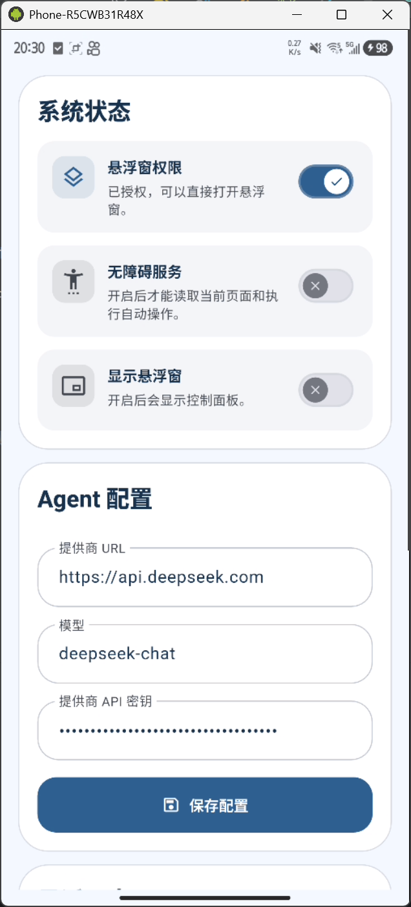
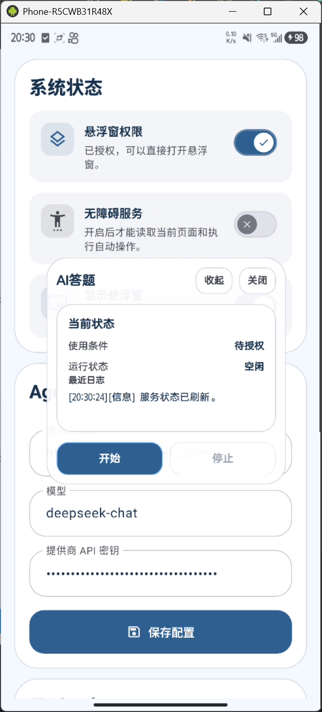

## 界面截图




## 学习通效果视频

学习通效果演示视频文件位于：`assets/videos/example.mp4`

<video src="assets/videos/example.mp4" controls width="360"></video>

如果当前平台不支持内嵌播放，可通过链接查看或下载：[example.mp4](assets/videos/example.mp4)

## 项目简介

应用主界面用于统一管理运行权限、代理配置和日志流，核心能力包括：

- 悬浮窗权限申请、显示控制与拖动模式切换
- 无障碍服务状态检测与系统设置跳转
- AI 提供商 URL、API Key、模型与运行阈值配置
- 基于 LangChain 的代理运行、停止与状态同步
- 题目上下文读取、UI 快照获取、滚动与返回等原生工具调用
- 悬浮窗面板与主应用之间的实时消息同步

## 技术栈

- Flutter
- GetX
- Dio + Retrofit
- SharedPreferences
- LangChain / langchain_openai
- flutter_overlay_window

### Flutter 环境

```shell
Flutter 3.41.2 • channel stable • https://github.com/flutter/flutter.git
Framework • revision 90673a4eef (5 weeks ago) • 2026-02-18 13:54:59 -0800
Engine • hash d96704abcce17ff165bbef9d77123407ef961017 (revision 6c0baaebf7) (1 months ago) • 2026-02-18 19:22:23.000Z
Tools • Dart 3.11.0 • DevTools 2.54.1
```

## 使用说明

1. 安装 Flutter 依赖：`flutter pub get`
2. 运行应用：`flutter run`
3. 首次进入应用后，先开启悬浮窗权限与无障碍服务
4. 配置大模型提供商地址、API Key 与模型名称后保存配置
5. 根据实际答题场景调整最大轮数、最长运行时间和保护阈值
6. 打开悬浮窗后启动代理，观察日志流与运行状态

## 注意事项

- 当前能力设计明显偏向 Android 设备场景，悬浮窗与无障碍能力依赖系统权限
- API Key 会保存在本地配置中，使用前应确认设备环境可信
- 代理到达提交页会自动停止，由人工确认后再执行最终提交

## 目录概览

- `lib/main.dart`：应用入口与悬浮窗入口
- `lib/app/pages/home/`：主界面、权限配置、日志展示
- `lib/app/pages/overlay/`：悬浮窗 UI 与交互
- `lib/app/agent/`：代理配置、运行状态、平台网关与运行时服务
- `lib/app/services/`：诊断提示与主界面/悬浮窗通信桥接

## 项目说明

本软件用于学习交流使用,可能存在一些问题和不足。  
欢迎大家提出宝贵意见和建议。如有任何关于代码、功能或使用方面的问题，欢迎提交 issue 或联系开发者。

## 开源协议

本项目基于 MIT 协议开源，允许在保留版权与许可声明的前提下进行使用、修改和分发。完整协议内容见 [LICENSE](LICENSE)。
